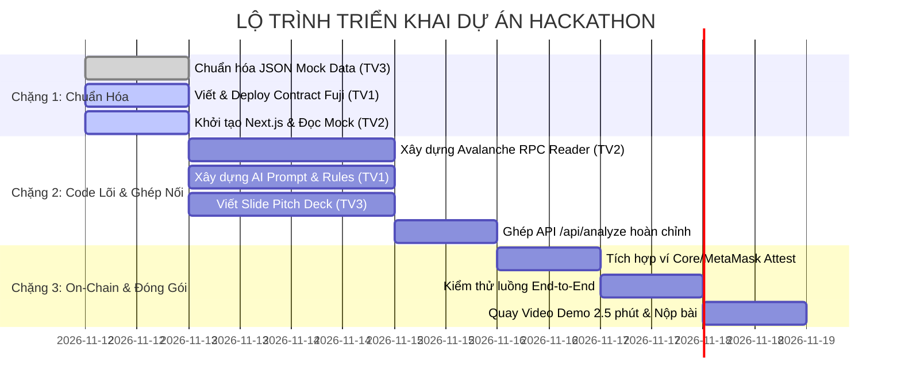

# 📋 Kế Hoạch Phân Công Công Việc & Lộ Trình Phát Triển Dự Án

> **Dự án:** Trợ lý AI ưu tiên lỗ hổng bảo mật Smart Contract theo rủi ro thực tế trên Avalanche  
> **Track:** AI Agents & Security | **Mạng mục tiêu:** Avalanche Fuji Testnet (Chain ID: `43113`)  
> **Repository:** Monorepo (`contracts/`, `backend/`, `frontend/`, `docs/`)

---

## 1. 🎯 Tổng Quan Mục Tiêu & Cơ Chế Lõi

### 1.1. Mục tiêu dự án
Giải quyết triệt để vấn đề **"Alert Fatigue"** (ngợp cảnh báo bảo mật) trong phát triển Web3. Hệ thống kết hợp phân tích mã tĩnh (Static/AST), truy vấn trực tiếp số dư tài sản trên **Avalanche C-Chain / Fuji RPC**, và suy luận logic từ **AI Agent** để ưu tiên xử lý các lỗ hổng thực sự đe dọa dòng tiền thay vì những cảnh báo lý thuyết suông.

### 1.2. Công thức tính điểm ưu tiên (Tri-Pillar Priority Score)

$$\text{Priority Score} = (0.4 \times \text{Exploitability}) + (0.3 \times \text{Exposure}) + (0.3 \times \text{Asset Impact})$$

*Tất cả trọng số thành phần đều được chuẩn hóa về thang điểm $0 - 100$:*

| Trụ cột (Pillar) | Trọng số | Định nghĩa kỹ thuật | Nguồn dữ liệu & Cơ chế thẩm định |
| :--- | :---: | :--- | :--- |
| **Exploitability** | **40%** | Mức độ khả thi khi hacker kích hoạt lỗi trên thực tế | Phân tích AST, điều kiện rẽ nhánh và Prompt LLM thẩm định đường dẫn tấn công (Attack Vector). |
| **Exposure** | **30%** | Độ phơi lộ bề mặt tấn công của hàm chứa lỗi | Kiểm tra modifier: `external`/`public` không kiểm soát (100đ) vs `onlyOwner`/`whenNotPaused` (10-20đ). |
| **Asset Impact** | **30%** | Giá trị tài sản thực tế có thể bị rút cạn (TVL) | Gọi RPC Avalanche Fuji (`eth_getBalance`, token balance) lấy lượng AVAX/Token đang bị khóa trong contract. |

### 1.3. Tính năng ghi nhận On-Chain (Audit Attestation)
Sau khi AI tính toán xong báo cáo, nhà phát triển có thể dùng ví Web3 ghi trực tiếp mã băm của báo cáo (`reportHash`) và điểm rủi ro (`priorityScore`) vào smart contract **`AvaTriageRegistry.sol`** trên Avalanche Fuji để tạo bằng chứng kiểm định minh bạch, bất biến.

---

## 2. 👥 Bảng Phân Công Nhiệm Vụ Chi Tiết

### 2.1. Ma trận trách nhiệm (RACI Matrix)

| Đầu việc chính | TV1 (InfoSec) | TV2 (SE / Web3) | TV3 (IS / Product) |
| :--- | :---: | :---: | :---: |
| Smart Contract & Deploy Fuji | **Accountable (A)** | Informed (I) | Consulted (C) |
| Bộ quy tắc chấm điểm & System Prompt AI | **Accountable (A)** | Responsible (R) | Consulted (C) |
| Avalanche RPC Reader & Core API | Consulted (C) | **Accountable (A)** | Informed (I) |
| Giao diện Web Dashboard & Web3 Wallet | Informed (I) | **Accountable (A)** | Consulted (C) |
| Mô hình quy đổi TVL & Mock Data JSON | Consulted (C) | Responsible (R) | **Accountable (A)** |
| Pitch Deck, Video Demo & Tiêu chí Hackathon | Consulted (C) | Consulted (C) | **Accountable (A)** |

---

### 2.2. Chi tiết công việc từng thành viên

#### 🛡️ THÀNH VIÊN 1: InfoSec Lead (Chuyên ngành An toàn thông tin)
- **Nhánh Git phụ trách:** `feat/infosec-contracts-rules`
- **Thư mục làm việc:** `/contracts` và thư mục con `backend/rules/`
- **Mục tiêu bàn giao:** Hợp đồng đăng ký lưu On-chain, bộ 3 contract mẫu thử nghiệm trên Fuji, cùng bộ luật và prompt cho AI.

**Checklist công việc:**
- [ ] **Smart Contracts:**
  - [ ] Viết `AvaTriageRegistry.sol`: Chứa hàm `recordAttestation(address targetContract, bytes32 reportHash, uint256 priorityScore, string memory ipfsUri)`.
  - [ ] Viết `VulnerableVault.sol` (Contract mẫu 1 - Critical): Chứa lỗi Reentrancy hàm `public withdraw()` rút cạn native AVAX.
  - [ ] Viết `AdminBugVault.sol` (Contract mẫu 2 - Low/Medium): Chứa logic lỗi tương tự nhưng được bọc modifier `onlyOwner`.
  - [ ] Viết `NoiseContract.sol` (Contract mẫu 3 - Noise/False Positive): Chỉ chứa các cảnh báo tĩnh vô hại (ví dụ: Floating pragma, unused local variable).
- [ ] **Deploy & Faucet Fuji Testnet:**
  - [ ] Viết script deploy bằng Hardhat/Foundry lên Avalanche Fuji (Chain ID: `43113`).
  - [ ] Nạp testnet AVAX (faucet từ `faucet.avax.network`) vào `VulnerableVault.sol` (ít nhất 2 - 5 AVAX) để tạo số dư on-chain phục vụ demo thực tế.
  - [ ] Verify mã nguồn contract trên Snowtrace Testnet và cập nhật địa chỉ contract vào file `contracts/DEPLOYED_ADDRESSES.md`.
- [ ] **Security Rules & System Prompt:**
  - [ ] Xây dựng ma trận tính điểm `Exploitability` và `Exposure` dạng bảng điều kiện logic.
  - [ ] Viết `system_prompt.txt` chuẩn cho LLM: Buộc AI trả về kết quả theo đúng cấu trúc JSON, giải thích rõ cơ chế tấn công và sinh đoạn mã vá lỗi dạng Diff (`- / +`).

---

#### 💻 THÀNH VIÊN 2: SE / Full-stack & Web3 Lead (Chuyên ngành Kỹ thuật phần mềm)
- **Nhánh Git phụ trách:** `feat/se-web-and-rpc`
- **Thư mục làm việc:** `/frontend` và `/backend`
- **Mục tiêu bàn giao:** API Server phân tích lỗ hổng hoàn chỉnh, kết nối Avalanche Fuji RPC và Dashboard hiển thị ma trận rủi ro có tích hợp ví.

**Checklist công việc:**
- [ ] **Avalanche RPC Context Fetcher (`/backend`):**
  - [ ] Cài đặt thư viện `viem` hoặc `ethers.js` kết nối RPC: `https://api.avax-test.network/ext/bc/C/rpc`.
  - [ ] Xây dựng module `fetchOnChainContext(contractAddress)`:
    - Lấy số dư native AVAX (`eth_getBalance`).
    - Lấy bytecode contract (`eth_getCode`) để xác nhận contract đã deploy.
    - Đọc trạng thái biến cờ khẩn cấp nếu có (`isPaused`, `owner`).
- [ ] **API Endpoint (`/backend`):**
  - [ ] Xây dựng endpoint `POST /api/analyze`: Nhận input (Source code Solidity hoặc Địa chỉ contract trên Fuji).
  - [ ] Ghép nối: Đọc RPC -> Gửi AST & Chain Context vào AI Prompt -> Nhận kết quả JSON -> Tính Priority Score tổng hợp theo công thức 3 trụ cột.
- [ ] **Web Dashboard UI (`/frontend`):**
  - [ ] Khởi tạo dự án Next.js (Tailwind CSS, Lucide icons, `@tanstack/react-query`).
  - [ ] Sử dụng tạm `docs/mock-data.json` của TV3 để dựng giao diện ngay trong ngày 1 mà không phải đợi backend.
  - [ ] Xây dựng bảng xếp hạng lỗi trực quan: Sắp xếp theo `Priority Score` giảm dần; hiển thị nhãn `CRITICAL`, `HIGH`, `MEDIUM`, `LOW`.
  - [ ] Thiết kế thanh tiến trình 3 màu đại diện cho 3 trụ cột: Exploitability (Đỏ), Exposure (Cam), Asset Impact (Tím Avalanche).
  - [ ] Tích hợp trình xem mã vá lỗi (Diff Patch Component) làm nổi bật đoạn code sửa đổi.
- [ ] **Tích hợp Web3 On-Chain:**
  - [ ] Tích hợp RainbowKit / Wagmi hỗ trợ mạng Avalanche Fuji và ví Core Wallet / MetaMask.
  - [ ] Viết nút bấm **"Attest on Avalanche Fuji"**: Gọi hàm `recordAttestation` của `AvaTriageRegistry.sol` để lưu hash báo cáo lên blockchain.

---

#### 📊 THÀNH VIÊN 3: IS / Data, Risk Model & Product Lead (Chuyên ngành Hệ thống thông tin)
- **Nhánh Git phụ trách:** `feat/is-data-and-docs`
- **Thư mục làm việc:** `/docs`, JSON Schema và tài liệu dự án
- **Mục tiêu bàn giao:** Chuẩn dữ liệu `mock-data.json`, mô hình chuyển đổi TVL sang Asset Impact, tài liệu kiến trúc, Slide Pitch Deck và Kịch bản Video Demo đạt điểm tối đa.

**Checklist công việc:**
- [ ] **Mô hình hóa dữ liệu & Mock Data:**
  - [ ] Thiết lập bảng thang đo phi tuyến tính chuẩn hóa từ số dư AVAX sang điểm số `Asset Impact` ($0 - 100$ điểm):
    - $0 \text{ AVAX} \rightarrow 0\text{ điểm}$
    - $0.01 - 1 \text{ AVAX} \rightarrow 25\text{ điểm}$
    - $1 - 10 \text{ AVAX} \rightarrow 60\text{ điểm}$
    - $10 - 100 \text{ AVAX} \rightarrow 85\text{ điểm}$
    - $> 100 \text{ AVAX} \rightarrow 100\text{ điểm}$
  - [ ] Hoàn thiện file `docs/mock-data.json` chuẩn hóa 100% schema JSON API cho TV2 import vào Frontend ngay lập tức.
- [ ] **Kiến trúc & Tài liệu Repository:**
  - [ ] Chuẩn hóa tài liệu `docs/ARCHITECTURE.md` kèm sơ đồ tuần tự (Sequence Diagram) và sơ đồ luồng dữ liệu (Dataflow).
  - [ ] Cập nhật `README.md` chính: Đảm bảo đầy đủ mô tả dự án, link Snowtrace contract, hướng dẫn cài đặt và video demo.
- [ ] **Pitch Deck (7 - 8 Slides Canva/Figma):**
  - [ ] Slide 1: Bìa (Tên dự án, Slogan, Track AI Agents & Security, Avalanche logo).
  - [ ] Slide 2: Problem - Báo động giả gây ngợp cảnh báo (Alert Fatigue) trong bảo mật Web3.
  - [ ] Slide 3: Solution - Hệ thống xếp hạng ưu tiên theo rủi ro thực tế (Context-Aware Triage).
  - [ ] Slide 4: Tri-Pillar Formula & Avalanche Integration (Nhấn mạnh việc đọc RPC trực tiếp số dư AVAX on-chain).
  - [ ] Slide 5: System Architecture & Workflow.
  - [ ] Slide 6: Demo Showcase & On-chain Attestation trên Fuji Testnet.
  - [ ] Slide 7: Business Value, Roadmap mở rộng sang Subnets/L1s và Avalanche Ecosystem.
- [ ] **Kịch bản & Quay Video Demo (2 phút 30 giây):**
  - [ ] Viết kịch bản video chi tiết đến từng giây:
    - *00:00 - 00:30:* Nêu thực trạng quét tĩnh ra 50 cảnh báo vô dụng.
    - *00:30 - 01:30:* Nhập địa chỉ contract `VulnerableVault.sol` trên Fuji; xem AI đọc số dư AVAX trực tiếp qua RPC và đẩy lỗi Reentrancy lên top 1 với điểm số 95+. So sánh với contract có `onlyOwner` bị hạ điểm rủi ro.
    - *01:30 - 02:00:* Xem AI sinh code vá lỗi (Diff Patch) và bấm ví xác nhận ghi Attestation lên Avalanche Fuji.
    - *02:00 - 02:30:* Mở Snowtrace xem giao dịch attestation thành công và kết bài.
  - [ ] Thu âm/lồng tiếng rõ ràng, chỉnh sửa video và upload lên YouTube/Loom (chế độ Unlisted/Public).

---

## 3. ⏱️ Lộ Trình Phối Hợp 3 Chặng (Không Nghẽn Cổ Chai)

Để cả 3 thành viên làm việc song song liên tục mà không ai phải chờ đợi code của người khác, quy trình được chia thành 3 mốc bàn giao nghiêm ngặt:

### Chặng 1: Thống nhất chuẩn giao tiếp & Dựng khung độc lập (Mốc 24h đầu)
- **TV3 bàn giao `docs/mock-data.json`:** Đây là bản "hợp đồng dữ liệu". TV2 chỉ cần nạp file này vào Next.js là có thể code 100% giao diện Dashboard, CSS và component mà không cần backend chạy được.
- **TV1 deploy hợp đồng mẫu lên Fuji:** Viết xong `AvaTriageRegistry.sol` và `VulnerableVault.sol`, deploy lên Fuji, nạp sẵn testnet AVAX và bàn giao địa chỉ contract cùng ABI cho TV2.
- **TV2 hoàn thành khung Frontend & Mock View:** Dựng xong trang web hiển thị bảng rủi ro lấy từ `mock-data.json`.

### Chặng 2: Triển khai logic lõi & Ghép nối API (Mốc 24h - 48h)
- **TV1 bàn giao Prompt & Logic chấm điểm:** Bàn giao file Prompt LLM có khả năng nhận diện AST và sinh mã Diff cho TV2.
- **TV2 ghép nối Backend:** Nối hàm gọi RPC Avalanche Fuji lấy số dư thật vào Prompt của TV1, hoàn thiện endpoint `POST /api/analyze`. Thay thế dữ liệu mock trên Frontend bằng API thực.
- **TV3 hoàn thành Pitch Deck (bản nháp):** Thiết kế toàn bộ slide nội dung, chuẩn bị sẵn cấu trúc bài thuyết trình bám theo tiêu chí chấm giải.

### Chặng 3: Tích hợp On-Chain, Kiểm thử & Đóng gói sản phẩm (Mốc 48h - Về đích)
- **Ghép nút Web3 Attestation:** TV2 tích hợp nút bấm ký giao dịch lưu kết quả vào `AvaTriageRegistry.sol` của TV1 trên Fuji.
- **Test E2E toàn hệ thống:** TV3 đóng vai trò người dùng/giám khảo kiểm thử toàn bộ luồng từ paste contract -> phân tích -> xem số dư AVAX -> xem diff patch -> ghi nhận on-chain.
- **Quay video & Đóng gói nộp bài:** TV3 chỉ đạo kịch bản và quay video demo 2.5 phút; TV1 rà soát mã nguồn; TV2 deploy web lên Vercel.

---

## 4. 📐 Quy Tắc Làm Việc Nhóm Trên Git (Git Collaboration Rules)

Nhằm đảm bảo **không bao giờ xảy ra xung đột mã nguồn (Merge Conflict)** và tuân thủ tuyệt đối quy định của ban tổ chức:

### 4.1. Quy tắc phân nhánh độc lập
- Nhánh chính bảo vệ: **`main`** (Chỉ dùng để nộp bài và chứa bản phát hành ổn định, không commit trực tiếp).
- Mỗi thành viên làm việc **100% trên nhánh riêng** của mình:
  - InfoSec Lead: `feat/infosec-contracts-rules`
  - Software Eng Lead: `feat/se-web-and-rpc`
  - Data/IS Lead: `feat/is-data-and-docs`

### 4.2. Quy tắc phạm vi thư mục (Boundary Rule)
- Mỗi thành viên chỉ chỉnh sửa trong thư mục được phân công:
  - TV1 phụ trách `/contracts` và file rules logic.
  - TV2 phụ trách `/frontend` và `/backend`.
  - TV3 phụ trách `/docs` và tài liệu gốc.
- Nếu cần sửa đổi chéo (ví dụ: TV2 cần ABI mới từ TV1), hãy trao đổi để người phụ trách thư mục đó commit lên nhánh của họ trước, sau đó tạo Pull Request vào `main`.

### 4.3. Quy chuẩn Commit Message
Sử dụng chuẩn **Conventional Commits**:
- `feat(contracts): add AvaTriageRegistry with attestation storage`
- `feat(backend): add avalanche rpc balance reader using viem`
- `feat(frontend): render priority score matrix with mock data`
- `docs(data): update mock-data schema with priority score breakdown`
- `fix(rules): adjust exposure weight calculation for internal functions`

### 4.4. Bảo mật tuyệt đối & Thể lệ cuộc thi (Zero Tolerance Checklist)
- ❌ **TUYỆT ĐỐI KHÔNG PUSH FILE `.env`:** Toàn bộ Private Key ví deploy, Gemini/OpenAI API Key phải đặt trong `.env` và đã được chặn trong `.gitignore`. Chỉ đẩy file mẫu `.env.example` không chứa key thật.
- ⚠️ **QUYỀN GIÁM KHẢO TRÊN GITHUB:**
  - Nếu Repo ở chế độ **Private**, bắt buộc kiểm tra mục `Settings` -> `Collaborators` đã có username **`tuantqse90`** chưa.
  - Nếu Repo ở chế độ **Public**, khuyến khích vẫn add để tránh lỗi quét tự động của ban giám khảo.
- ✅ **TESTNET NẠP SẴN AVAX:** Đảm bảo các contract demo trên Fuji Testnet luôn có sẵn số dư AVAX để ban giám khảo bấm nút kiểm tra là RPC trả về số dư thực tế ngay lập tức.
