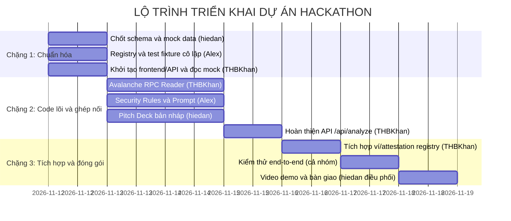

# 📋 Kế Hoạch Phân Công Công Việc & Lộ Trình Phát Triển Dự Án

> **Dự án:** Trợ lý AI ưu tiên lỗ hổng bảo mật Smart Contract theo rủi ro thực tế trên Avalanche  
> **Track:** AI Agents & Security | **Mạng mục tiêu:** Avalanche Fuji Testnet (Chain ID: `43113`)  
> **Repository:** Monorepo (`contracts/`, `backend/`, `frontend/`, `docs/`)

---

## 1. 🎯 Tổng Quan Mục Tiêu & Cơ Chế Lõi

### 1.1. Mục tiêu dự án

Dự án hướng đến giảm **Alert Fatigue** (quá tải cảnh báo bảo mật) trong phát triển Web3. Hệ thống kết hợp phân tích mã nguồn tĩnh/AST, thông tin ngữ cảnh on-chain và AI để xếp hạng phát hiện theo mức độ rủi ro thực tế. Kết quả phân tích cần có giải thích, mức độ ưu tiên và gợi ý khắc phục để đội phát triển xử lý vấn đề quan trọng trước.

### 1.2. Công thức tính điểm ưu tiên (Tri-Pillar Priority Score)

$$\text{Priority Score} = (0.4 \times \text{Exploitability}) + (0.3 \times \text{Exposure}) + (0.3 \times \text{Asset Impact})$$

*Tất cả điểm thành phần được chuẩn hóa về thang điểm 0–100.*

| Trụ cột (Pillar) | Trọng số | Định nghĩa kỹ thuật | Nguồn dữ liệu & cơ chế thẩm định |
| :--- | :---: | :--- | :--- |
| **Exploitability** | **40%** | Mức độ khả thi để một điều kiện lỗi có thể dẫn đến tác động bảo mật | AST, luồng điều khiển, điều kiện gọi hàm và đánh giá có kiểm chứng; AI chỉ hỗ trợ phân tích, không tự thực thi giao dịch |
| **Exposure** | **30%** | Mức độ có thể tiếp cận của hàm hoặc đường đi chứa phát hiện | Visibility, modifier, quyền truy cập và trạng thái kiểm soát như `onlyOwner`/`whenNotPaused` |
| **Asset Impact** | **30%** | Mức độ tài sản có thể chịu ảnh hưởng theo dữ liệu sẵn có | Ngữ cảnh RPC đọc công khai, gồm số dư native/token khi truy cập được; ghi rõ dữ liệu thiếu hoặc không xác minh được |

### 1.3. Ghi nhận On-Chain (Audit Attestation)

Sau khi xem xét báo cáo, người dùng có thể dùng ví Web3 ghi `reportHash` và `priorityScore` lên registry trên Avalanche Fuji. Chỉ gửi giao dịch sau khi người dùng chủ động xác nhận trong ví. Không đưa private key hoặc seed phrase vào ứng dụng.

### 1.4. Nguyên tắc an toàn cho dữ liệu và mẫu kiểm thử

- Mọi kiểm tra chỉ thực hiện trên mã nguồn do người dùng cung cấp hoặc địa chỉ mà người dùng được phép đánh giá.
- Contract mẫu có lỗi (nếu cần để kiểm thử phát hiện) chỉ chạy trong môi trường local/test cô lập. Không triển khai hoặc nạp tiền thật/testnet vào mẫu cố ý có lỗ hổng.
- Các truy vấn Fuji chỉ đọc dữ liệu công khai; không tự động gọi hàm làm thay đổi trạng thái của contract mục tiêu.
- Mọi kết quả do AI sinh ra cần được con người rà soát trước khi áp dụng.

---

## 2. 👥 Bảng Phân Công Nhiệm Vụ Chi Tiết

### 2.1. Thành viên và vai trò

| Thành viên | Chuyên môn | Vai trò chính | Nhánh Git phụ trách |
| :--- | :--- | :--- | :--- |
| **Alexvuong2006** | An toàn thông tin (InfoSec) | Security Lead | `feat/infosec-contracts-rules` |
| **Bạn (THBKhan)** | Kỹ thuật phần mềm (Software Engineering) | Full-stack & Web3 Lead | `feat/se-web-and-rpc` |
| **hiedan** | Hệ thống thông tin (Information Systems) | Data, Risk Model & Product Lead | `feat/is-data-and-docs` |

### 2.2. Ma trận trách nhiệm (RACI Matrix)

| Đầu việc chính | Alexvuong2006 (InfoSec) | Bạn / THBKhan (Kỹ thuật phần mềm) | hiedan (Hệ thống thông tin) |
| :--- | :---: | :---: | :---: |
| Thiết kế security rules và tiêu chí phân tích | **A/R** | C | C |
| Thiết kế, rà soát và kiểm thử contract registry | **A/R** | C | I |
| Contract mẫu kiểm thử cô lập | **A/R** | C | I |
| Avalanche RPC Reader và API | C | **A/R** | I |
| Frontend Dashboard và tích hợp ví | C | **A/R** | C |
| Mô hình dữ liệu, Asset Impact và mock data | C | C | **A/R** |
| Kiến trúc tài liệu, pitch deck và kịch bản demo | C | C | **A/R** |
| Kiểm thử end-to-end và chuẩn bị bàn giao | R | R | **A** |

> **R** = Responsible (thực hiện), **A** = Accountable (chịu trách nhiệm cuối), **C** = Consulted (tham vấn), **I** = Informed (được cập nhật).

### 2.3. Chi tiết công việc từng thành viên

#### 🛡️ Alexvuong2006 — InfoSec Lead (Chuyên ngành An toàn thông tin)

- **Nhánh Git:** `feat/infosec-contracts-rules`
- **Phạm vi:** `/contracts` và phần security rules/prompt trong `/backend/rules/` (phối hợp với THBKhan khi tích hợp).
- **Mục tiêu bàn giao:** Quy tắc phân tích và chấm điểm có giải thích; registry attestation được rà soát; bộ fixture kiểm thử bảo mật chạy trong môi trường cô lập.

**Checklist:**

- [ ] **Smart contract và kiểm thử bảo mật:**
  - [ ] Xây dựng `AvaTriageRegistry.sol` với hàm ghi nhận báo cáo, ví dụ `recordAttestation(address targetContract, bytes32 reportHash, uint256 priorityScore, string memory ipfsUri)`.
  - [ ] Tạo fixture đại diện cho các mức phát hiện khác nhau để kiểm tra khả năng phân loại; fixture có lỗi chỉ được chạy trên local chain/test harness cô lập, không triển khai lên Fuji và không nạp tài sản.
  - [ ] Rà soát quyền truy cập, kiểm tra đầu vào, sự kiện và các trường hợp biên của registry.
  - [ ] Viết test tự động cho registry và các quy tắc nhận diện; không dùng test để tương tác với contract ngoài phạm vi được phép.
- [ ] **Triển khai registry:**
  - [ ] Phối hợp với THBKhan viết và rà soát script triển khai registry lên Fuji, nếu cần cho demo.
  - [ ] Lưu địa chỉ registry, chain ID và liên kết explorer trong `contracts/DEPLOYED_ADDRESSES.md`; không lưu khóa bí mật trong repository.
- [ ] **Security Rules & System Prompt:**
  - [ ] Xây dựng ma trận điều kiện chấm `Exploitability` và `Exposure`, nêu rõ giả định và giới hạn.
  - [ ] Viết `system_prompt.txt` yêu cầu đầu ra JSON đúng schema, giải thích bằng chứng, độ tin cậy và gợi ý khắc phục dạng diff.
  - [ ] Đặt quy tắc để AI không khẳng định phát hiện nếu thiếu bằng chứng; phân biệt dữ kiện on-chain với suy luận.

#### 💻 Bạn (THBKhan) — Software Engineering / Full-stack & Web3 Lead (Chuyên ngành Kỹ thuật phần mềm)

- **Nhánh Git:** `feat/se-web-and-rpc`
- **Phạm vi:** `/frontend` và `/backend`; phối hợp với Alexvuong2006 về rules/ABI và với hiedan về schema/mock data.
- **Mục tiêu bàn giao:** Sản phẩm chạy được từ giao diện đến API, đọc ngữ cảnh Fuji theo chế độ chỉ đọc và hỗ trợ người dùng chủ động ghi attestation.

**Checklist:**

- [ ] **Avalanche RPC Context Fetcher (`/backend`):**
  - [ ] Dùng `viem` hoặc `ethers.js` kết nối RPC Fuji: `https://api.avax-test.network/ext/bc/C/rpc`.
  - [ ] Xây dựng `fetchOnChainContext(contractAddress)` để đọc số dư native (`eth_getBalance`), bytecode (`eth_getCode`) và trạng thái cần thiết nếu có ABI phù hợp.
  - [ ] Xác thực địa chỉ, xử lý lỗi RPC, timeout và giới hạn tần suất; không gửi giao dịch đến contract mục tiêu.
- [ ] **API Endpoint (`/backend`):**
  - [ ] Xây dựng `POST /api/analyze`, nhận mã Solidity hoặc địa chỉ contract trên Fuji theo schema đã thống nhất.
  - [ ] Kết hợp phân tích mã, ngữ cảnh chain và security rules; trả JSON có điểm thành phần, Priority Score, bằng chứng, cảnh báo giới hạn dữ liệu và đề xuất sửa.
  - [ ] Bảo vệ API key bằng biến môi trường; không ghi secret hoặc dữ liệu nhạy cảm vào log.
- [ ] **Web Dashboard (`/frontend`):**
  - [ ] Khởi tạo hoặc hoàn thiện ứng dụng Next.js với Tailwind CSS, Lucide icons và `@tanstack/react-query` nếu phù hợp với cấu trúc repo.
  - [ ] Dùng `docs/mock-data.json` do hiedan chuẩn bị để dựng giao diện song song với backend.
  - [ ] Hiển thị danh sách phát hiện theo Priority Score giảm dần, với nhãn `CRITICAL`, `HIGH`, `MEDIUM`, `LOW`.
  - [ ] Hiển thị ba thành phần điểm: Exploitability, Exposure và Asset Impact; làm rõ khi dữ liệu on-chain không khả dụng.
  - [ ] Tích hợp trình xem diff patch; phân biệt đề xuất AI với thay đổi đã được người dùng chấp thuận.
- [ ] **Tích hợp Web3 Attestation:**
  - [ ] Tích hợp Wagmi/RainbowKit (hoặc giải pháp tương đương) cho Avalanche Fuji và ví Core Wallet/MetaMask.
  - [ ] Xây dựng nút **“Attest on Avalanche Fuji”** gọi registry đã được xác nhận; hiển thị rõ nội dung giao dịch và yêu cầu người dùng xác nhận trong ví.
  - [ ] Kiểm tra chain ID và địa chỉ registry trước khi gửi; không yêu cầu hoặc lưu private key.
- [ ] **Tích hợp và bàn giao:**
  - [ ] Viết test cho API, RPC reader và luồng giao diện chính.
  - [ ] Cập nhật hướng dẫn chạy ứng dụng, cấu hình `.env.example` (chỉ tên biến, không có secret) và phối hợp deploy bản demo.

#### 📊 hiedan — Data, Risk Model & Product Lead (Chuyên ngành Hệ thống thông tin)

- **Nhánh Git:** `feat/is-data-and-docs`
- **Phạm vi:** `/docs`, JSON Schema và tài liệu dự án.
- **Mục tiêu bàn giao:** Schema dữ liệu thống nhất, mô hình Asset Impact minh bạch, tài liệu kiến trúc, pitch deck và kịch bản demo.

**Checklist:**

- [ ] **Mô hình dữ liệu & Mock Data:**
  - [ ] Đề xuất thang đo phi tuyến tính từ số dư AVAX sang điểm `Asset Impact` (0–100), ghi rõ đây là mô hình demo và cần hiệu chỉnh theo bối cảnh.
  - [ ] Hoàn thiện `docs/mock-data.json` theo schema API đã thống nhất với THBKhan.
  - [ ] Bổ sung trường nguồn dữ liệu, thời điểm truy vấn, trạng thái thiếu dữ liệu và giải thích điểm số để người xem hiểu giới hạn của kết quả.
- [ ] **Kiến trúc & tài liệu repository:**
  - [ ] Viết `docs/ARCHITECTURE.md` với sơ đồ tuần tự (Sequence Diagram), sơ đồ luồng dữ liệu (Dataflow), các ranh giới tin cậy và luồng xác nhận của người dùng.
  - [ ] Phối hợp cập nhật `README.md`: mô tả dự án, cài đặt, cấu hình, cách chạy test và liên kết registry/explorer nếu đã triển khai.
- [ ] **Pitch Deck (7–8 slides):**
  - [ ] Bìa: tên dự án, slogan, track và Avalanche.
  - [ ] Problem: Alert Fatigue trong bảo mật Web3.
  - [ ] Solution: Context-Aware Triage.
  - [ ] Tri-Pillar Formula và cách sử dụng dữ liệu RPC.
  - [ ] Kiến trúc hệ thống và workflow.
  - [ ] Demo Dashboard và attestation trên Fuji.
  - [ ] Giá trị sản phẩm, giới hạn hiện tại và roadmap mở rộng.
- [ ] **Kịch bản & video demo (khoảng 2 phút 30 giây):**
  - [ ] 00:00–00:30: Nêu vấn đề quá tải cảnh báo.
  - [ ] 00:30–01:30: Phân tích mã mẫu an toàn trong demo, xem ngữ cảnh RPC đọc công khai và thứ tự ưu tiên.
  - [ ] 01:30–02:00: Xem giải thích/diff đề xuất và xác nhận attestation bằng ví.
  - [ ] 02:00–02:30: Mở explorer xem giao dịch registry và kết luận.
  - [ ] Đảm bảo demo không triển khai hoặc tương tác tấn công với contract có lỗ hổng; dùng dữ liệu mẫu/fixture local khi cần.

---

## 3. ⏱️ Lộ Trình Phối Hợp 3 Chặng

Các đầu việc được chia để ba thành viên có thể làm song song. Thời lượng dưới đây là ước tính, có thể điều chỉnh theo tiến độ thực tế.

### Chặng 1: Thống nhất chuẩn giao tiếp & dựng khung độc lập

- **hiedan:** Chốt `docs/mock-data.json` và schema dữ liệu để frontend có thể phát triển độc lập.
- **Alexvuong2006:** Xây registry và fixture kiểm thử cô lập; bàn giao ABI/schema và ghi chú bảo mật.
- **THBKhan:** Dựng khung frontend/API, đọc mock data và thống nhất hợp đồng API với hai thành viên.

### Chặng 2: Triển khai logic lõi & ghép nối API

- **Alexvuong2006:** Bàn giao security rules, tiêu chí điểm và prompt có schema đầu ra thống nhất.
- **THBKhan:** Tích hợp RPC chỉ đọc, rules và API `POST /api/analyze`; chuyển giao diện từ mock sang API.
- **hiedan:** Hoàn thiện mô hình dữ liệu, tài liệu kiến trúc và bản nháp pitch deck.

### Chặng 3: Tích hợp, kiểm thử & đóng gói

- **THBKhan:** Tích hợp ví để ghi attestation lên registry Fuji sau khi người dùng xác nhận.
- **Cả nhóm:** Kiểm thử end-to-end từ nhập mã/địa chỉ được phép đánh giá đến xem báo cáo và attestation.
- **hiedan:** Điều phối kịch bản/video demo; **Alexvuong2006** rà soát bảo mật; **THBKhan** chuẩn bị bản triển khai ứng dụng.

---

## 4. 📐 Quy Tắc Làm Việc Nhóm Trên Git

### 4.1. Quy tắc phân nhánh

- Nhánh chính `main` chứa bản ổn định; không commit trực tiếp.
- Mỗi thành viên làm việc trên nhánh phụ trách:
  - Alexvuong2006: `feat/infosec-contracts-rules`
  - THBKhan: `feat/se-web-and-rpc`
  - hiedan: `feat/is-data-and-docs`
- Mọi thay đổi được đưa vào `main` thông qua Pull Request và cần thành viên phụ trách liên quan review.

### 4.2. Phạm vi thư mục

- **Alexvuong2006:** `/contracts` và security rules trong `/backend/rules/`.
- **THBKhan:** `/frontend` và `/backend` (trừ phần rules do Alex phụ trách; thay đổi chéo cần phối hợp).
- **hiedan:** `/docs`, JSON Schema và tài liệu gốc.
- Khi cần sửa ngoài phạm vi, trao đổi với người phụ trách trước; thống nhất schema/ABI qua Pull Request để tránh xung đột.

### 4.3. Quy chuẩn commit message

Sử dụng Conventional Commits, ví dụ:

- `feat(contracts): add attestation registry`
- `feat(backend): add read-only avalanche rpc context`
- `feat(frontend): render priority score matrix`
- `docs(data): document risk score schema`
- `fix(rules): clarify exposure scoring for restricted functions`

### 4.4. Bảo mật và chuẩn bị demo

- ❌ **Không commit `.env`, private key, seed phrase hoặc API key.** Dùng `.gitignore` và chỉ đưa `.env.example` không chứa secret.
- ✅ Kiểm tra quyền truy cập repository và thêm người cần thiết theo yêu cầu của ban tổ chức.
- ✅ Registry demo trên Fuji chỉ lưu attestation do người dùng chủ động xác nhận; kiểm tra đúng chain ID và địa chỉ contract.
- ✅ Contract fixture có lỗi chỉ chạy trong môi trường local/test cô lập; không nạp AVAX hay tài sản vào fixture và không triển khai fixture đó lên Fuji.
- ✅ Demo dùng dữ liệu giả lập hoặc dữ liệu công khai được phép truy cập; không thực hiện giao dịch làm thay đổi trạng thái của contract bên thứ ba.
