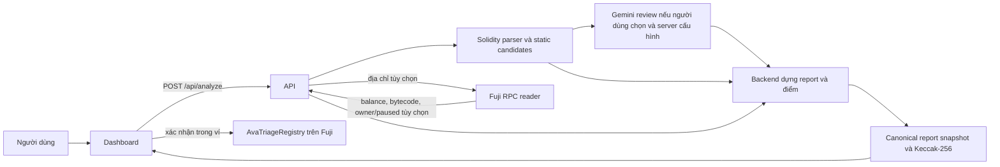
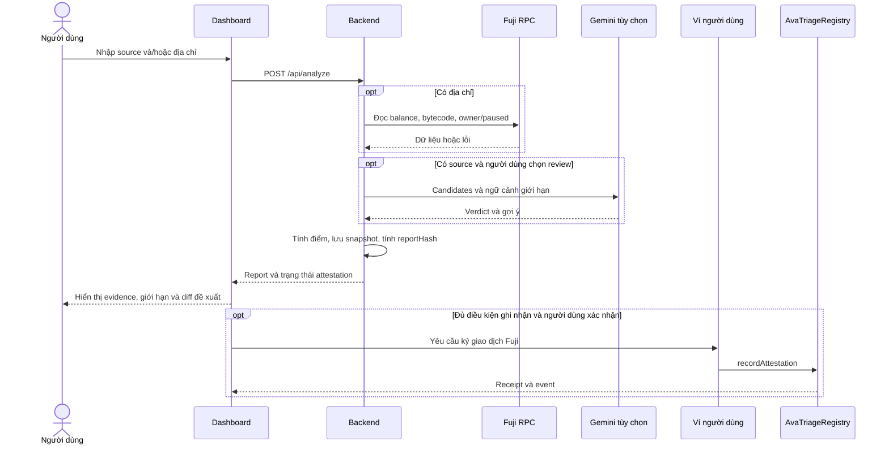

# Kiến trúc hiện tại

Repo gồm bốn module: `frontend/` (HTML, CSS, JavaScript module), `backend/` (Express, TypeScript), `contracts/` (registry và fixture Hardhat), `docs/` (hợp đồng dữ liệu và hướng dẫn). Backend phục vụ dashboard và API cùng origin. Hệ thống chỉ truy vấn Avalanche Fuji (chain ID 43113) khi có địa chỉ hợp lệ.

## Luồng dữ liệu

Số dư AVAX là **ngữ cảnh**. Backend hiện đặt `assetImpact = 0` vì chưa xác minh được tài sản nào thực sự chịu rủi ro và chưa chứng minh source được gửi khớp bytecode của địa chỉ. Không suy ra TVL hoặc số tiền có thể mất từ `eth_getBalance`. Mô hình demo cho ngày sau nằm tại [data/ASSET_IMPACT_MODEL.md](data/ASSET_IMPACT_MODEL.md); chưa được nối vào chấm điểm runtime.

Provenance trong response nằm ở `targetContract.dataSource`: `fuji-rpc` khi đã thử đọc Fuji, `none` khi chỉ có source. RPC thành công có `queriedAt`; RPC thất bại có `attemptedAt`, `status: unavailable` và `warning`. `report.scoreExplanation` ghi công thức, điểm report và giới hạn Asset Impact trong chính snapshot được hash.

## Trình tự phân tích và ghi nhận

## Quy tắc điểm đang chạy

Backend tính `Math.round((4E + 3X + 3A) / 10)` cho từng candidate, với `E`, `X`, `A` trong 0–100. `A = 0` trong bản hiện tại. Điểm report là điểm lớn nhất của findings được Gemini review là `potential-issue`, hoặc `0` nếu không có. Nhãn: `CRITICAL` ≥80, `HIGH` ≥60, `MEDIUM` ≥40, còn lại `LOW`. `0` ở Asset Impact là giá trị thay thế khi thiếu bằng chứng, **không phải kết luận không có tài sản**.

## Ranh giới tin cậy

| Nguồn | Cách xử lý |
|---|---|
| Source và comment do người dùng gửi | Dữ liệu không tin cậy; parser tạo candidates, model chỉ review candidates; người dùng rà soát kết quả. |
| Fuji RPC công khai | Đọc ngữ cảnh theo địa chỉ; lỗi RPC được thể hiện rõ; dữ liệu on-chain không xác minh source đã gửi. |
| Gemini | Chỉ chạy khi được chọn và cấu hình; verdict/diff là nhận xét, không tự áp dụng patch hoặc đặt điểm/hash. |
| Backend | Chủ sở hữu tính điểm, canonical snapshot và `reportHash`; snapshot lưu riêng, không phục vụ qua HTTP. |
| Trình duyệt và ví | Chỉ người dùng xác nhận giao dịch; ví ký, backend không giữ private key. |

Với address-only, API trả `context-only`, không có AST, findings, score hay report hash. Với source và RPC lỗi, API vẫn có thể trả report kèm `targetContract.status = unavailable`. Xem [API_SPECIFICATION.md](API_SPECIFICATION.md) để biết cấu trúc phản hồi và [registry-integration.md](registry-integration.md) cho điều kiện ghi nhận.
