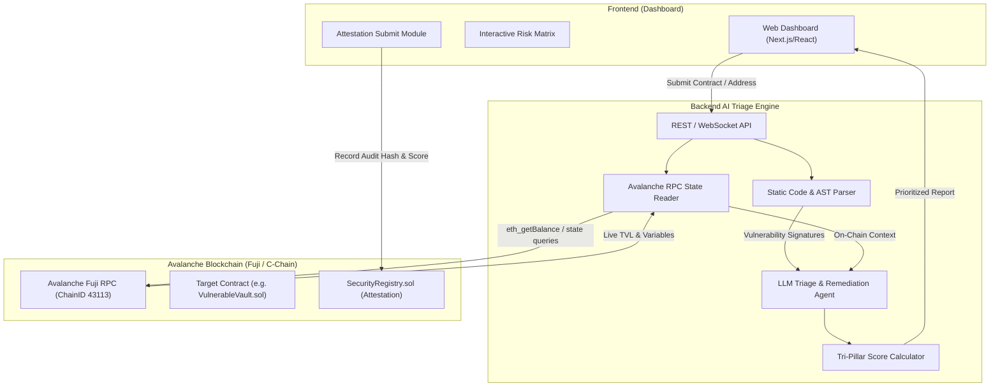

# 📐 System Architecture: AI-Powered Smart Contract Vulnerability Triage on Avalanche

## 1. Executive Summary

This project addresses smart contract **alert fatigue** by moving beyond theoretical static analysis. It provides an autonomous **Risk-Weighted Triage Agent** tailored for the Avalanche ecosystem, fusing static code analysis, real-time Avalanche C-Chain / Fuji RPC state inspection, and LLM-driven exploit validation.

---

## 2. Tri-Pillar Priority Scoring Engine

$$\text{Priority Score} = (0.4 \times \text{Exploitability}) + (0.3 \times \text{Exposure}) + (0.3 \times \text{Asset Impact})$$

Each parameter is normalized on a scale from $0$ to $100$:

| Pillar | Weight | Description | Evaluation Mechanism |
| :--- | :---: | :--- | :--- |
| **Exploitability** | 40% | Probability and technical feasibility of execution | LLM reasoning against AST & call trace constraints |
| **Exposure** | 30% | Accessibility of vulnerable functions | Visibility modifiers (`public`/`external`), modifiers (`onlyOwner`, `whenNotPaused`) |
| **Asset Impact** | 30% | Total Value Locked (TVL) and assets at risk | Real-time Avalanche Fuji RPC queries (`eth_getBalance`, ERC-20 balances) |

### Risk Classification
- **Critical (Score 80 - 100):** Publicly callable, proven exploit path, high TVL currently held in contract.
- **High (Score 60 - 79):** High exploitability or exposure with moderate TVL.
- **Medium (Score 40 - 59):** Restricted exposure or low real-world asset value at risk.
- **Low / Informational (Score < 40):** Theoretical issues, restricted functions, or zero on-chain TVL.

---

## 3. Subsystem Breakdown

### 3.1. Contracts (`/contracts`)
- **`SecurityRegistry.sol`**: An on-chain attestation registry deployed on Avalanche Fuji. Stores immutable verification proofs:
  - Target Contract Address
  - Vulnerability Report IPFS/Arweave Hash
  - Computed Priority Score
  - Auditor / AI Agent Signature
- **`VulnerableVault.sol`**: Demo target contract holding real Fuji testnet AVAX to demonstrate live TVL risk valuation and exploit triage.

### 3.2. Backend Engine (`/backend`)
- **AST / Static Parser**: Extracts functions, modifiers, parameters, and external calls.
- **Avalanche RPC Context Fetcher**:
  - Endpoint: `https://api.avax-test.network/ext/bc/C/rpc`
  - Retrieves balance (`eth_getBalance`), contract bytecode (`eth_getCode`), and storage states.
- **AI Triage Agent**: Prompts structured LLM with extracted AST + Live Avalanche on-chain state to generate:
  - Exploit feasibility analysis
  - Tri-pillar score breakdown
  - Concrete diff-based code patch recommendations

### 3.3. Frontend Dashboard (`/frontend`)
- **Input View**: Submit Solidity source code or verified Avalanche Fuji contract address.
- **Risk Heatmap**: Prioritized vulnerability table sorting by Priority Score rather than raw severity.
- **Diff Patch Viewer**: Visual code remediation diff.
- **Attestation Action**: Web3 wallet (Core / MetaMask) connection to write triage attestation directly to `SecurityRegistry.sol` on Fuji.

---

## 4. Environment & Network Specifications

- **Avalanche Fuji Testnet RPC**: `https://api.avax-test.network/ext/bc/C/rpc`
- **Chain ID**: `43113`
- **Currency**: `AVAX`
- **Explorer**: [Snowtrace Fuji](https://testnet.snowtrace.io/)
