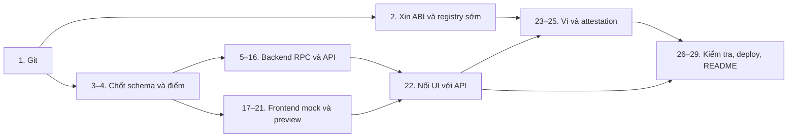

# Kế hoạch thực thi: SE Web & RPC

> **Người phụ trách:** THBKhan  
> **Nhánh:** `feat/se-web-and-rpc`  
> **Mục tiêu:** Hoàn thành luồng demo từ phân tích Solidity hoặc ngữ cảnh Fuji đến dashboard và attestation do người dùng chủ động xác nhận.

## Quy ước trạng thái

| Ký hiệu | Ý nghĩa |
|---|---|
| `[ ]` | Chưa làm |
| `[-]` | Đang làm |
| `[x]` | Hoàn thành |
| `[!]` | Bị chặn hoặc cần phối hợp |

Chỉ đổi trạng thái sau khi thỏa tiêu chí hoàn thành của từng mục. Ghi ngày và ghi chú ngắn ở cột cuối để dễ bàn giao.

## Các quyết định đã chốt

| Nội dung | Quyết định |
|---|---|
| Nguồn Solidity | Khi chỉ nhận `contractAddress`, demo chỉ trả ngữ cảnh on-chain. Không tuyên bố đã có Solidity source, AST hay phát hiện lỗ hổng từ bytecode. |
| Lỗi RPC | Có `sourceCode`: trả `200` với kết quả phân tích source và `targetContract.status: "unavailable"`. Chỉ có `contractAddress`: trả `502` khi RPC không đọc được dữ liệu. |
| Thang điểm | `Exploitability`, `Exposure`, `Asset Impact` đều là `0–100`. Backend tính `0.4E + 0.3X + 0.3A`, áp dụng quy tắc demo half-up và lấy điểm cao nhất trong nhóm `potential-issue` (0 nếu nhóm rỗng) và chỉ trả `priorityScore` nguyên, phù hợp ABI contract. Frontend không tính hoặc làm tròn lại score. |
| Patch | Hiển thị nhãn **AI đề xuất**. Bản demo không tự áp dụng patch và không cần luồng chấp thuận/từ chối riêng. |
| Attestation | Nút **Attest on Avalanche Fuji** gọi `recordAttestation(targetContract, reportHash, priorityScore, ipfsUri)` sau khi người dùng xác nhận trong ví. |
| Hash và lưu báo cáo | Backend tạo `reportHash` từ đúng snapshot report cuối cùng đã trả cho UI: chuẩn hóa theo JSON Canonicalization Scheme (RFC 8785), mã hóa UTF-8, rồi băm Keccak-256. Snapshot đã hash chứa `priorityScore` nguyên cuối cùng. UI dùng hash kèm report đang hiển thị, không chạy phân tích lại hay tính lại hash lúc attest. Trong demo, `ipfsUri` dùng chuỗi rỗng chỉ khi ABI/contract cho phép; nếu không, dùng URI placeholder đã được Alex xác nhận. Chưa tích hợp dịch vụ IPFS nếu chưa có provider và quyền truy cập rõ ràng. |
| Cấu hình bí mật | API key LLM chỉ ở backend. `NEXT_PUBLIC_*` chỉ chứa cấu hình công khai. Không commit private key, seed phrase hoặc secret. |

### Snapshot dùng cho `reportHash`

- Chốt payload `report` trong schema: chứa toàn bộ dữ liệu báo cáo người dùng đang xem, gồm `queriedAt` và `priorityScore` nguyên cuối cùng. `reportHash` nằm ngoài payload này để tránh tự băm chính nó; metadata lưu trữ như `ipfsUri` cũng nằm ngoài payload.
- Backend chuẩn hóa payload bằng JSON Canonicalization Scheme (RFC 8785), mã hóa UTF-8 rồi băm Keccak-256. Lưu nguyên snapshot cùng canonical bytes và hash để có thể tải lại, xác minh và attest đúng báo cáo đã xem. Không chỉ dựa vào thứ tự key ổn định.
- Frontend không tính hoặc làm tròn lại score. Bước 24 dùng snapshot đã lưu theo quy trình RFC 8785 này; xác minh lại hash phải dùng snapshot đó, không gọi phân tích/RPC mới. Thay đổi `queriedAt` hay bất kỳ nội dung report nào tạo snapshot mới, cần được người dùng xem lại trước khi attest.

## Thông tin cần Alex xác nhận sớm

Gửi yêu cầu này ngay sau bước 1, không chờ các phần backend/frontend hoàn thành:

| Nội dung cần xác nhận | Lý do |
|---|---|
| ABI và địa chỉ registry Fuji | Cần để cấu hình và kiểm thử attestation. |
| Chữ ký chính xác của `recordAttestation` | Tránh encode sai thứ tự hoặc kiểu tham số. |
| Kiểu `priorityScore` và quy tắc làm tròn | Contract thường nhận số nguyên. Backend chỉ gửi score nguyên theo quy tắc Alex xác nhận, trong phạm vi contract cho phép. |
| Có chấp nhận `ipfsUri` rỗng không | Quyết định dùng placeholder hay cần tích hợp IPFS trước demo. |
| Explorer testnet chuẩn của nhóm | Hiển thị đúng liên kết giao dịch trên UI và README. |

## Bảng theo dõi thực hiện

| # | Trạng thái | Công việc | Chi tiết cần làm | Phụ thuộc / phối hợp | Tiêu chí hoàn thành | Ngày / ghi chú |
|---:|:---:|---|---|---|---|---|
| 1 | `[x]` | Kiểm tra Git | Chạy `git status`; xác nhận nhánh hiện tại. Tạo hoặc chuyển sang `feat/se-web-and-rpc` khi worktree an toàn. Không commit trực tiếp vào `main`. | — | `git branch --show-current` trả `feat/se-web-and-rpc`; không làm mất thay đổi cục bộ. | 2026-11-17: Đã xác nhận nhánh `feat/se-web-and-rpc`, worktree an toàn, thay đổi cục bộ được giữ nguyên. |
| 2 | `[x]` | Xin dữ liệu registry sớm | Ngay sau bước 1, xin ABI đã rà soát, địa chỉ registry Fuji, explorer link và thông tin triển khai từ Alex. Đồng thời hỏi kiểu `priorityScore`, quy tắc làm tròn và khả năng chấp nhận `ipfsUri` rỗng. | Alex | ABI có hàm `recordAttestation`; địa chỉ, Fuji Chain ID, kiểu score và quy ước URI được xác nhận. | 2026-11-20: Registry đã deploy trên Fuji và bytecode khớp bản build. Địa chỉ và tx hash ở contracts/DEPLOYED_ADDRESSES.md. |
| 3 | `[x]` | Chốt schema | Đối chiếu `docs/mock-data.json`; chốt request và response API cho dashboard/backend. Response có pillar scores, priority, severity, findings, evidence, `patchDiff`, confidence, nguồn, thời điểm, trạng thái dữ liệu on-chain và `reportHash` khi có report hoàn chỉnh. | Hiedan, Alex | Mock data và API dùng cùng tên trường, kiểu dữ liệu, enum severity và quy tắc dữ liệu thiếu. Chỉ đánh dấu hoàn thành khi schema compile và validate fixtures bằng validator thật. | 2026-11-17: Đã biên dịch schema Draft 2020-12 và vượt qua 33/33 test cases positive/negative bằng Ajv 2020; các quyết định nghiệp vụ còn thiếu đã được ghi nhận trong `docs/API_SPECIFICATION.md`. |
| 4 | `[-]` | Chốt mô hình điểm | Xác nhận ba pillar và thang `0–100`; định nghĩa ngưỡng `CRITICAL`, `HIGH`, `MEDIUM`, `LOW` và quy tắc làm tròn theo ABI registry. Backend là nơi duy nhất tính/làm tròn score. | Hiedan, Alex | Có ví dụ đầu vào/đầu ra; backend trả `priorityScore` nguyên từ công thức `0.4E + 0.3X + 0.3A`. | 2026-11-20: Theo review của Alex trên PR #2: Math.round(raw), max của các finding potential-issue hoặc 0 nếu không có. Asset Impact chưa xác minh dùng 0. |
| 5 | `[x]` | Cài nền backend | Xác định package manager và cấu trúc backend hiện có. Cài `viem`, `zod` và dependency cần thiết trong đúng workspace. | Cấu trúc repo | Lệnh cài đặt không làm hỏng package lock; backend khởi động được. | 2026-11-17: Khởi tạo Node.js + TypeScript + Express trong `backend/`; tách `createApp`; build/typecheck và test passing. |
| 6 | `[x]` | Biến môi trường | Tạo `.env.example` cho backend/frontend: `FUJI_RPC_URL`, `LLM_API_KEY`, `NEXT_PUBLIC_WC_PROJECT_ID`, `NEXT_PUBLIC_REGISTRY_ADDRESS`, `NEXT_PUBLIC_API_URL`. Kiểm tra `.gitignore`. | Bước 5 | Không có secret thật trong repo; `.env.example` có giá trị minh họa an toàn trước khi cấu hình RPC/Vercel. | 2026-11-17: Đã tạo `backend/.env.example` và `frontend/.env.example`; kiểm tra .gitignore chặn .env và cho phép .env.example. |
| 7 | `[x]` | Tạo Fuji RPC client | Tạo client đọc công khai cho Fuji, Chain ID `43113`; dùng URL RPC cấu hình qua `FUJI_RPC_URL`. | Bước 6 | Client dùng đúng chain và không có khả năng gửi giao dịch tới contract mục tiêu. | 2026-11-17: Đã tạo `createFujiRpcClient` qua `viem`, Chain ID 43113, retryCount=0, hỗ trợ mock transport, không có signer. |
| 8 | `[x]` | Viết `fetchOnChainContext` | Xác thực địa chỉ bằng `isAddress`; đọc native balance và bytecode. Trả `address`, `balanceAvax`, `isContract`, `queriedAt`, trạng thái và lỗi có cấu trúc. | Bước 7 | Hàm không gọi RPC với địa chỉ sai; bytecode `0x` được đánh dấu chưa có contract (không khẳng định chắc chắn là EOA). | 2026-11-17: Hoàn thành `src/rpc/context.ts`; balanceAvax formatEther chuỗi chính xác; test pass 32/32. |
| 9 | `[x]` | Đọc hàm tùy chọn | Thử đọc `paused()` và `owner()` bằng ABI tối thiểu, từng hàm có `try/catch`. Nếu không hỗ trợ, trả `null` và trạng thái `unavailable`, không suy luận an toàn. | Bước 8 | Kết quả phân biệt giá trị đã đọc với dữ liệu không xác minh được. | 2026-11-17: Đọc độc lập `owner()` và `paused()` qua ABI tối thiểu; lỗi không làm mất balance/bytecode đã đọc. |
| 10 | `[x]` | Độ bền RPC | Đặt timeout 8–10 giây; retry tối đa 2–3 lần với lỗi tạm thời như rate limit/transport; backoff theo cấp số nhân; cache theo address trong vài chục giây. | Bước 8 | Có mã lỗi `INVALID_ADDRESS`, `RPC_TIMEOUT`, `RATE_LIMITED`, `RPC_ERROR`, `WRONG_NETWORK`; tổng thời gian chờ có giới hạn. | 2026-11-17: Ngân sách tổng 10s, maxRetries 0–2; AbortController gắn vào HTTP transport; bảo toàn dữ liệu cốt lõi khi optional call hết thời gian. |
| 11 | `[x]` | Script kiểm tra RPC | Tạo `scripts/test-rpc.ts` hoặc script tương đương để gọi `fetchOnChainContext`. | Bước 8–10 | Chạy với địa chỉ Fuji hợp lệ in ra số dư AVAX thật; địa chỉ sai trả `INVALID_ADDRESS` và không crash. | 2026-11-17: Tạo `src/scripts/test-rpc.ts`; kiểm thử offline và chạy live query Fuji ghi trực tiếp ra `docs/evidence/live-rpc-output.txt` kèm kiểm tra bất biến địa chỉ bằng code. |
| 12 | `[x]` | Xác định request API | Nhận `sourceCode`, `contractAddress`, hoặc cả hai; từ chối request thiếu cả hai. Giới hạn kích thước source code và xác thực địa chỉ. Với request chỉ có address, schema cho phép `pillarScores`, `priorityScore`, `severity`, `findings` và `reportHash` vắng mặt. | Bước 3 | Request schema có kiểm tra rõ ràng và báo lỗi `400` khi input không hợp lệ. | 2026-11-17: Compile schema một lần qua Ajv 2020; từ chối request thiếu cả hai, source rỗng, zero address, trường thừa bằng 400 INVALID_REQUEST/INVALID_ADDRESS. |
| 13 | `[x]` | Luồng phân tích source | Parse source/AST khi có `sourceCode`; trích xuất AST facts và bằng chứng rules sơ bộ; nạp security rules/prompt do Alex bàn giao; gọi model; kiểm tra output model bằng Zod. Coi toàn bộ source code, bao gồm comment, là dữ liệu không tin cậy. | Alex | Không có source thì không tuyên bố đã phân tích AST. Output model sai schema không được trả thẳng về client. | 2026-11-20: Smoke test live đạt với `gemini-3.5-flash-lite`, review 1 candidate. `POST /api/analyze` trả `200`, verdict `dismissed` cho mẫu Solidity và hash khớp snapshot đã lưu. Gemini 3.8 Flash trả `503 UNAVAILABLE`. |
| 14 | `[x]` | Ghép điểm, snapshot và API | Tạo `POST /api/analyze`; kết hợp source, context on-chain và rules. Backend tính score nguyên/severity theo bước 4, dựng report snapshot cuối, canonicalize bằng RFC 8785, UTF-8 và băm Keccak-256 thành `reportHash` trước khi trả UI. | Bước 4, 8, 13 | Response khớp schema ở bước 3; `priorityScore` và `reportHash` thuộc cùng snapshot, findings sắp xếp giảm dần theo score. | 2026-11-20: Source API tạo report, tính điểm, canonicalize RFC 8785, lưu snapshot rồi trả Keccak-256; ca kiểm thử xác nhận hash khớp byte lưu. |
| 15 | `[x]` | Quy tắc lỗi API | Có source mà RPC hỏng: trả `200` kèm cảnh báo/context `unavailable`. Chỉ có address mà RPC hỏng: trả `502`. Input sai: `400`; người gọi vượt giới hạn API của hệ thống: `429`; RPC upstream bị rate limit sau retry: xử lý như RPC hỏng; model failure: `502`. | Bước 14 | Mỗi trường hợp trả mã HTTP và payload có thể hiển thị trên UI. | 2026-11-20: HTTP tests đạt cho address-only, source, lỗi RPC và payload; thêm giới hạn dùng chung 429 và lỗi Gemini 502/503. |
| 16 | `[x]` | Tài liệu API | Viết `docs/api-examples.md` với ví dụ source-only, address-only, source + address và RPC không khả dụng. | Bước 14–15 | Có ví dụ request/response hợp lệ, không chứa key hoặc dữ liệu nhạy cảm. | 2026-11-20: Đã có ví dụ source-only, address-only, source kèm address, lỗi RPC và giới hạn. |
| 17 | `[x]` | Dựng frontend mock | Dùng HTML, CSS và JavaScript module; phục vụ mock và API từ một origin. | Bước 3 | `npm run dev` chạy được; dashboard dùng mock data đúng schema. | 2026-11-20: Dashboard dùng HTML/CSS và JavaScript module trên cùng Express origin, có mẫu độc lập. |
| 18 | `[x]` | Findings matrix | Hiển thị findings theo điểm giảm dần với badge `CRITICAL`, `HIGH`, `MEDIUM`, `LOW`; hiển thị bằng chứng và trạng thái thiếu dữ liệu. | Bước 17 | Thứ tự, severity và warning khớp mock data. | 2026-11-20: Hiển thị và lọc findings, evidence, độ tin cậy và giới hạn. |
| 19 | `[x]` | Pillar bars và diff | Hiển thị ba thanh điểm Exploitability, Exposure, Asset Impact. Diff phân biệt dòng thêm/xóa và gắn nhãn **AI đề xuất**. | Bước 17 | Không có UI nào tự áp dụng patch vào source code. | 2026-11-20: Có thanh điểm và diff có nhãn, chỉ hiển thị đề xuất. |
| 20 | `[x]` | Kiểm tra giao diện | Kiểm tra dashboard ở desktop và mobile width; có loading, empty state và error state. | Bước 17–19 | Các thành phần chính đọc được và không vỡ layout ở mobile. | 2026-11-20: Đã kiểm tra luồng phân tích trong Edge và viewport mobile; không tràn ngang. |
| 21 | `[!]` | Deploy preview frontend | Đóng gói preview UI và API cùng nhau để triển khai. | Bước 6, 17–20 | Preview URL hiển thị dashboard mock và phát hiện được lỗi build/config sớm. | 2026-11-20: Preview local chạy. Một bản deploy chung phục vụ UI và API, chờ môi trường hosting. |
| 22 | `[x]` | Nối frontend với API | Chuyển hook dữ liệu từ mock sang `POST /api/analyze`; giữ nguyên snapshot report, `priorityScore` và `reportHash` mà API trả về. Với report không có `priorityScore`, ẩn pillar/findings không có và vô hiệu hóa attestation. | Bước 14–20 | Nhập source/address nhận được report, loading/error/warning hiển thị đúng; nút attest chỉ bật khi có score và hash hợp lệ. | 2026-11-20: Form gọi cùng origin, hiển thị snapshot và tắt ghi nhận với address-only. |
| 23 | `[-]` | Cấu hình ví Fuji | Tích hợp ví EIP-1193, kết nối và đổi sang mạng Fuji trước khi ký. | Bước 2 | Core Wallet/MetaMask kết nối được và nhận biết sai mạng. | 2026-11-20: Dùng ví EIP-1193 và kiểm tra mạng Fuji; đã test provider giả. |
| 24 | `[x]` | Chuẩn bị attestation snapshot | Gắn `reportHash`, `priorityScore` nguyên và `ipfsUri` đã nhận/xác nhận vào đúng report snapshot người dùng đang xem. Không gửi transaction từ kết quả phân tích lại sau đó. | Bước 2, 14, 22 | Report hiển thị, hash và score dùng để attest thuộc cùng một snapshot không bị frontend sửa đổi. | 2026-11-20: Chuẩn bị tham số trực tiếp từ báo cáo hiện tại và khóa khi người dùng xác nhận. |
| 25 | `[-]` | Viết attestation | Gọi recordAttestation từ ví người dùng; chỉ xác nhận thành công khi receipt có event khớp snapshot. | Bước 2, 23–24 | Ví hiển thị nội dung giao dịch; UI có trạng thái pending, success với tx hash/explorer và lỗi từ chối/thiếu gas. | 2026-11-20: Đã chạy API với verdict mẫu và gửi giao dịch qua mã ví lên Hardhat cục bộ. Receipt, event và trạng thái registry khớp hash của snapshot đã lưu, score nguyên 7 và URI rỗng. |
| 26 | `[x]` | Kiểm tra Fuji | Dùng test AVAX từ faucet, gửi một attestation do người dùng chủ động xác nhận, xem trên explorer testnet. | Bước 25 | Giao dịch thành công, hash và event/transaction xem được trên explorer. | 2026-11-20: Giao dịch smoke do người dùng xác nhận đã ghi attestation ID 0 tại block 61344940. Receipt, event và dữ liệu registry khớp hash của snapshot đã lưu, score 0 và URI rỗng. [Giao dịch Fuji](https://testnet.snowtrace.io/tx/0xc6e222e40e7c3fa43adfa5583bda1fe9c583c99323234c78a5ab2a3c731cccc4). |
| 27 | `[-]` | Deploy backend | Chọn nơi chạy backend; cấu hình CORS, URL API production, env variables và health check. Nếu chưa deploy kịp, nêu rõ demo frontend đang dùng mock. | Bước 6, 14–16 | Frontend production gọi API được, hoặc README nêu chính xác giới hạn mock. | 2026-11-20: Có Dockerfile, storage volume và health check. Chưa có URL deploy. |
| 28 | `[-]` | Build và rà soát cuối | Chạy build frontend/backend theo scripts hiện có; kiểm tra `git grep` không có key thật; kiểm thử luồng source, address, lỗi RPC, mobile UI và attestation. | Tất cả bước trước | Demo chạy theo README, không cần thông tin ngoài tài liệu dự án. | 2026-11-20: Build, test API, test ví mock và browser QA đã chạy. Gemini live với 3.5 Flash-Lite và smoke test registry trên Fuji đã xác minh. Kiểm thử ký trên dashboard cần báo cáo có `potential-issue`. |
| 29 | `[x]` | Cập nhật README | Ghi cách cài đặt, biến môi trường, lệnh chạy, chế độ mock/live API, registry/explorer, quy tắc address-only không attest và giới hạn: bytecode không tương đương Solidity source. | Bước 6, 27–28 | Thành viên khác có thể dựng demo theo README. | 2026-11-20: README, hướng dẫn demo, deployment và giới hạn đã cập nhật. |

## Thứ tự và phần việc song song

Sau bước 3, có thể chạy song song ba luồng. Bước 2 phải được khởi động ngay sau bước 1 vì phụ thuộc vào phản hồi từ Alex:

1. Backend: bước 5–16, trong đó tạo `.env.example` ở bước 6 trước khi cấu hình RPC.
2. Frontend mock và Vercel preview: bước 17–21.
3. Phối hợp contract: bước 2, rồi tiếp tục phần ví/attestation ở bước 23–25.

## Điều kiện demo hoàn chỉnh

- [ ] Người dùng nhập Solidity source và nhận báo cáo có ba pillar, score, findings, evidence và patch AI đề xuất.
- [ ] Người dùng nhập Fuji address và chỉ nhận ngữ cảnh on-chain được đánh dấu rõ giới hạn phân tích.
- [ ] RPC lỗi không làm mất báo cáo source có sẵn; UI hiển thị cảnh báo dữ liệu on-chain không khả dụng.
- [ ] Attestation chỉ bật cho report có `priorityScore` hợp lệ, dùng `reportHash` xác định và `ipfsUri` theo quy ước registry đã xác nhận.
- [ ] Dashboard chạy được trên URL preview/production và hiển thị tốt ở mobile.
- [ ] Người dùng có thể kết nối ví Fuji, xem dữ liệu giao dịch và chủ động ký một attestation.
- [ ] README và `.env.example` đủ để thành viên khác chạy lại demo mà không dùng secret thật.
